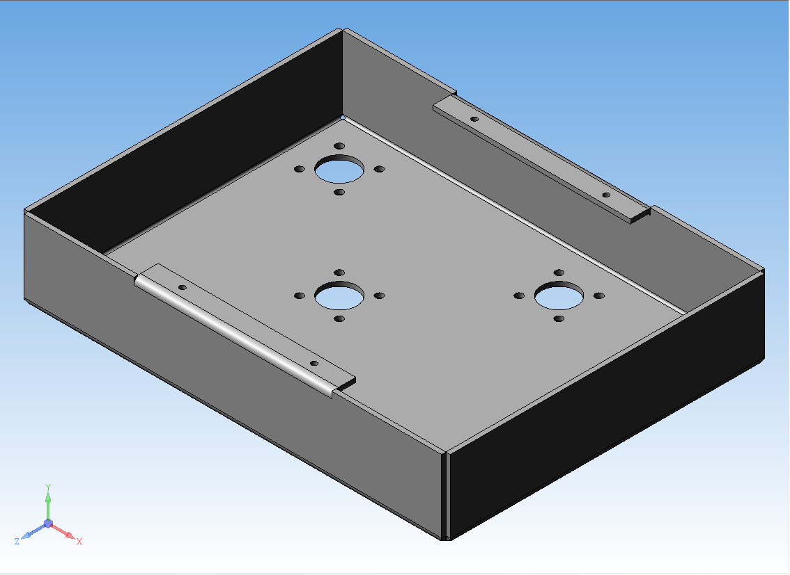

# KOMPAS-AI-CAD: Инженерная автоматизация КОМПАС-3D с помощью ИИ-агентов

Инженерный Python-фреймворк для параметрического 3D-моделирования в **КОМПАС-3D (v16.1 — v25)** под управлением ИИ-агентов (**Claude Code / Cline / локальные LLM через Ollama**) в среде VS Code.



## Ключевые особенности

- **Чистый Python-фасад (`kompas_core.py`):** создание эскизов на базовых плоскостях и гранях тела, базовых и вырезающих выдавливаний (включая режим «Через всё»), тел вращения, геометрический поиск плоских и цилиндрических граней (`get_planar_face_at`, `get_cylindrical_face`), конструктивных осей, смещенных плоскостей и массивов без громоздкого низкоуровневого COM-кода.
- **Эталонная конструкторская параметризация:**
  - Программное создание таблицы переменных детали (`API7 IVariable7`) с осмысленными русскими комментариями.
  - Простановка настоящих линейных и диаметральных размеров в 2D-эскизах (`dim_hor`, `dim_ver`, `dim_diam`) с автоматической параметризацией эскиза до статуса **`(+)` (полностью определен)**.
  - Автоматическая привязка математических выражений (`D`, `ds`, `o1`, `h-s`, `s`, `D/2`) к внутренним переменным эскизов и 3D-операций (`v382`, `v408` и т.д.).
- **Живое дерево построения:** на выходе формируются нативные модели `.m3d` (использование массивов по концентрической сетке, привязка эскизов к граням, сквозные вырезы), полностью готовые к ручному редактированию и выпуску чертежей по ЕСКД.
- **Тройной контур самопроверки ИИ (Validation Pipeline):**
  1. **Операционный контроль:** автоматическая сверка изменения физического объема (`Volume`) до и после каждого выреза или выдавливания.
  2. **Габаритный контроль (`assert_bbox`):** жесткая сверка реального габаритного контейнера модели (`GetGabarit`) с расчетными размерами ТЗ.
  3. **Визуальный VLM-контроль:** автоматический рендер `.png` снимков для визуальной проверки геометрии мультимодальным агентом.
- **Безопасное управление окном КОМПАС-3D:** подключение к уже открытому окну программы с подавлением блокирующих модальных диалогов (`ksEnableTaskAccess(0)`) на время работы скрипта и автоматическое закрытие незавершенных вкладок при отладке.

## Области применения
1. **Тела вращения и осесимметричные детали:** ступенчатые валы, фланцевые втулки, штуцеры, шкивы, направляющие ролики.
2. **Корпусные детали и станочные приспособления:** кондукторы, прижимы, базовые плиты, кронштейны, опоры.
3. **Листовые детали и штамповая оснастка:** гнутые клеммы, лепестки, развертки, пуансоны, матрицы, съемники и ловители.

## Структура проекта
```text
├── .claude/
│   └── CLAUDE.md          # Инженерные правила и стандарты построения для ИИ-агента
├── example/               # Эталонные модели (.m3d), слепки (_blueprint.md) и скриншоты
├── output/                # Сгенерированные 3D-модели (.m3d) и рендеры (.png)
├── sdk_ref/               # Сгенерированные спецификации типов КОМПАС API5 и API7
├── inspect_m3d.py         # Универсальный декомпилятор эталонных моделей (.m3d -> _blueprint.md)
├── kompas_core.py         # Ядро управления КОМПАС-3D и параметризации
└── build_flange.py        # Эталонный скрипт построения параметрической фланцевой втулки
```

## Быстрый старт
1. **Настройка виртуального окружения (Git Bash / PowerShell)**
```bash
python -m venv .venv
source .venv/Scripts/activate
pip install pywin32
python .venv/Scripts/pywin32_postinstall.py -install
```
2. **Генерация локальных оберток типов КОМПАС API5 / API7 (при необходимости)**
Если папка sdk_ref/ не содержит .py оберток, сгенерируйте типизированные модули напрямую из установленного КОМПАС-3D:
```bash
mkdir -p sdk_ref
.venv/Scripts/python.exe -c "
from win32com.client import makepy
makepy.GenerateFromTypeLibSpec(r'C:\Program Files\ASCON\KOMPAS-3D V16\Bin\kAPI5.tlb', open('sdk_ref/kompas_api5_v16.py', 'w', encoding='utf-8'))
makepy.GenerateFromTypeLibSpec(r'C:\Program Files\ASCON\KOMPAS-3D V16\Bin\kAPI7.tlb', open('sdk_ref/kompas_api7_v16.py', 'w', encoding='utf-8'))
"
```
3. **Запуск эталонного примера**
Откройте КОМПАС-3D и выполните:
```bash
.venv/Scripts/python.exe build_flange.py
```
Скрипт создаст параметрическую фланцевую втулку с таблицей переменных, полностью определенными эскизами (+) и круговым массивом крепежных отверстий, проверит её габариты и сохранит результат в output/flange.m3d и output/flange.png.

4. **Обучение ИИ-агента на собственных 3D-моделях (inspect_m3d.py)**
Вы можете обучать агента своему конструкторскому стилю напрямую через 3D-модели КОМПАС-3D без написания длинных текстовых инструкций:
  Поместите любую образцовую деталь .m3d в папку example/.
  Запустите декомпилятор моделей:
```bash
.venv/Scripts/python.exe inspect_m3d.py
```
  Декомпилятор автоматически создаст файл example/<имя_модели>_blueprint.md с таблицей переменных, деревом построения, геометрией эскизов и формулами параметров, по которому Claude Code сможет воспроизводить аналогичные детали.